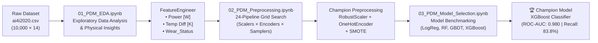

# 📓 Predictive Maintenance (PdM) — Notebooks Documentation

This directory contains the end-to-end experimental workflow, exploratory data analysis (EDA), physics-informed feature engineering, preprocessing pipeline experiments, and machine learning model benchmarking for the **Predictive Maintenance (PdM)** module of the **Smart IIoT Monitoring System**.

All experiments are conducted on the **AI4I 2020 Predictive Maintenance Dataset** (`../data/raw/ai4i2020.csv`) and tracked via **MLflow** integrated with **DagsHub**.

---

## 🧭 Experimental Workflow Overview



| Order | Notebook | Experiment Phase | MLflow Experiment Name | Key Outcome |
| :---: | :--- | :--- | :--- | :--- |
| **01** | [`01_PDM_EDA.ipynb`](./01_PDM_EDA.ipynb) | Phase 1: Exploratory Data Analysis | *N/A (Local Visual Audit)* | Identified 3.39% class imbalance, sensor outlier behavior, and physics-based collinearities ($\tau \times \omega$, $\Delta T$). |
| **02** | [`02_PDM_Preprocessing.ipynb`](./02_PDM_Preprocessing.ipynb) | Phase 1.5: Preprocessing & Feature Engineering | `Predictive_Maintenance_IIOT_Preprocessing` | Evaluated 24 pipeline combinations; selected `FeatureEngineer` + `RobustScaler` + `OneHotEncoder` + `SMOTE`. |
| **03** | [`03_PDM_Model_Selection.ipynb`](./03_PDM_Model_Selection.ipynb) | Phase 2: Model Selection & Benchmarking | `Predictive_Maintenance_IIOT_Model_Selection` | Benchmarked 4 classifiers on 5-fold CV and holdout set; selected **XGBoost** as the Champion architecture. |

---

## 📂 Directory Contents & Asset Inventory

```text
notebooks/
├── 01_PDM_EDA.ipynb                        # Phase 1: Exploratory Data Analysis notebook
├── 02_PDM_Preprocessing.ipynb              # Phase 1.5: Feature engineering & 24-pipeline preprocessing experiment
├── 03_PDM_Model_Selection.ipynb            # Phase 2: Candidate classifier benchmarking & selection
├── README.md                               # Documentation for the notebooks directory
│
├── output.png                              # [EDA] Target class distribution (Normal vs. Machine failure)
├── output2.png                             # [EDA] Univariate histograms & KDEs for all 5 sensor features
├── output3.png                             # [EDA] Boxplots of sensor readings highlighting rotational speed & torque outliers
├── output4.png                             # [EDA] Machine failure count stratified by Product Quality Type (L, M, H)
├── output5.png                             # [EDA] Pearson correlation heatmap (Sensors vs. Machine failure)
│
├── Screenshot (118).png                    # [Phase 1.5] MLflow parallel coordinates plot for the 24 preprocessing runs
├── confusion_matrix.png                    # [Phase 1.5] Holdout confusion matrix artifact generated during pipeline grid search
│
├── image.png                               # [Phase 2] MLflow parallel coordinates plot comparing the 4 candidate models
├── confusion_matrix_LogReg.png             # [Phase 2] Holdout confusion matrix for Logistic Regression
├── confusion_matrix_RandomForest.png       # [Phase 2] Holdout confusion matrix for Random Forest
├── confusion_matrix_GradientBoosting.png   # [Phase 2] Holdout confusion matrix for Gradient Boosting
└── confusion_matrix_XGBoost.png            # [Phase 2] Holdout confusion matrix for XGBoost (Champion)
```

---

## 📘 Detailed Notebook Breakdown

### 1. `01_PDM_EDA.ipynb` — Exploratory Data Analysis & Strategic Plan

**Objective:** Audit dataset quality, analyze univariate and multivariate sensor distributions, quantify target class imbalance, and formulate physics-informed hypotheses for feature engineering.

#### Key Findings & Analysis
1. **Dataset Integrity:**
   - **Shape:** `10,000` records across `14` columns (`UDI`, `Product ID`, `Type`, 5 physical sensors, binary target `Machine failure`, and 5 specific failure mode flags: `TWF`, `HDF`, `PWF`, `OSF`, `RNF`).
   - **Completeness:** `0` missing values and `0` duplicate `UDI` rows.
2. **Severe Target Class Imbalance (`output.png`):**
   - **Normal Operation (`0`):** `9,661` samples (**96.61%**)
   - **Machine Failure (`1`):** `339` samples (**3.39%**)
   - **Modeling Implication:** Accuracy is misleading (a naive majority-class classifier achieves 96.61% accuracy). Evaluation must prioritize **Recall** (minimizing costly False Negatives / missed failures) alongside **F1-Score** and **ROC-AUC**.
3. **Univariate Sensor Profiles (`output2.png`, `output3.png`):**
   - **`Air temperature [K]` & `Process temperature [K]`:** Multi-modal distributions (`295K–304K` and `306K–314K` respectively) with a consistent ~`10K` thermal offset.
   - **`Torque [Nm]`:** Normally distributed around `40 Nm`, with extreme high/low outliers (`< 10 Nm` and `> 70 Nm`) corresponding to Overstrain Failures (`OSF`).
   - **`Rotational speed [rpm]`:** Right-skewed distribution peaking near `1500 rpm` with a heavy upper tail extending to `2800+ rpm` (linked to Power Failures, `PWF`).
   - **`Tool wear [min]`:** Uniformly distributed across `0–250 min`, capturing full tool lifecycles up to Tool Wear Failure (`TWF`).
4. **Categorical Quality Impact (`output4.png`):**
   - Product quality tier (`Type`) strongly influences failure rates:
     - **Low Quality (`L`):** `3.9%` failure rate
     - **Medium Quality (`M`):** `2.8%` failure rate
     - **High Quality (`H`):** `2.1%` failure rate
5. **Multivariate Correlation Structure (`output5.png`):**
   - **Torque vs. Rotational Speed ($r = -0.88$):** Strong negative correlation reflecting mechanical power physics ($P = \tau \times \omega$).
   - **Air Temp vs. Process Temp ($r = +0.88$):** Strong positive collinearity; isolating the temperature differential ($\Delta T$) separates machine-generated heat from ambient temperature fluctuations.
   - **Top Linear Failure Correlates:** `Torque [Nm]` ($r = +0.19$) and `Tool wear [min]` ($r = +0.11$).

---

### 2. `02_PDM_Preprocessing.ipynb` — Feature Engineering & Preprocessing Grid Search

**Objective:** Implement a scikit-learn compatible physics-informed feature engineering transformer and systematically evaluate **24 preprocessing & resampling pipeline combinations** to establish the Champion Preprocessing Pipeline.

#### Physics-Informed Feature Engineering (`FeatureEngineer`)
Inherits from `sklearn.base.BaseEstimator` and `sklearn.base.TransformerMixin` for seamless integration inside `imblearn.pipeline.Pipeline` without data leakage:

| Engineered Feature | Formula / Definition | Physical Rationale |
| :--- | :--- | :--- |
| **`Power [W]`** | $\text{Torque [Nm]} \times \left(\text{Rotational speed [rpm]} \times \frac{2\pi}{60}\right)$ | Captures mechanical power output and non-linear interaction between load and speed (`PWF` / `OSF`). |
| **`Temp Diff [K]`** | $\text{Process temperature [K]} - \text{Air temperature [K]}$ | Isolates heat dissipation efficiency from ambient room temperature (`HDF`). |
| **`Wear_Status`** | `pd.cut(Tool wear [min], bins=[-1, 60, 180, 300], labels=[0, 1, 2])` | Discretizes tool lifecycle into **New (`0`)**, **Used (`1`)**, and **Critical (`2`)** regimes (`TWF`). |

#### Leakage Prevention & Data Split
- **Dropped Identifiers:** `UDI`, `Product ID`
- **Dropped Target Leakage Columns:** `TWF`, `HDF`, `PWF`, `OSF`, `RNF` (sub-failure modes that directly encode the target `Machine failure`).
- **Train/Test Split:** 80% Training (`8,000` rows) / 20% Holdout Test (`2,000` rows), stratified on `Machine failure` (`random_state=42`).

#### 24-Pipeline Grid Search Design
Tracked in MLflow under experiment `Predictive_Maintenance_IIOT_Preprocessing` using 5-fold `StratifiedKFold` cross-validation:
- **Scalers (2):** `StandardScaler` vs. `RobustScaler`
- **Categorical Encoders for `Type` (2):** `OneHotEncoder(handle_unknown='ignore')` vs. `OrdinalEncoder(categories=[['L', 'M', 'H']])`
- **Imbalance Strategies (3):** `None` (with model `class_weight='balanced'`), `SMOTE(random_state=42)`, `RandomOverSampler(random_state=42)`
- **Baseline Models (2):** `LogisticRegression(max_iter=1000)` vs. `RandomForestClassifier(n_estimators=50)`

#### Key Benchmark Results (5-Fold CV on Training Split)

| Scaler | Encoder | Imbalance Strategy | Model | CV Recall (Mean) | CV F1 (Mean) | Takeaway |
| :--- | :--- | :--- | :--- | :---: | :---: | :--- |
| `RobustScaler` | `OneHotEncoder` | **`SMOTE`** | **`RandomForest`** | **0.7932** | **0.7611** | ✅ **Selected Champion Preprocessing** (Best Recall/F1 balance for trees) |
| `StandardScaler` | `OneHotEncoder` | `SMOTE` | `RandomForest` | 0.7932 | 0.7611 | Tied on trees, but `RobustScaler` preferred for outlier resilience |
| `RobustScaler` | `OrdinalEncoder` | `SMOTE` | `RandomForest` | 0.7859 | 0.7425 | Slightly lower Recall & F1 than `OneHotEncoder` |
| `StandardScaler` | `OrdinalEncoder` | `RandomOverSampler` | `RandomForest` | 0.7527 | 0.8202 | Higher precision, but misses ~25% of failures |
| `RobustScaler` | `OneHotEncoder` | `None` (`class_weight`) | `RandomForest` | 0.6861 | 0.8004 | Misses >31% of machine failures (unacceptable safety risk) |
| `RobustScaler` | `OneHotEncoder` | `SMOTE` | `LogReg` | 0.8306 | 0.2805 | ❌ Linear model fails due to severe false alarms (F1 ~ 0.28) |

---

### 3. `03_PDM_Model_Selection.ipynb` — Model Selection & Benchmarking

**Objective:** Benchmark four distinct classification architectures ontop of the Champion Preprocessing Pipeline (`FeatureEngineer` $\rightarrow$ `RobustScaler` + `OneHotEncoder` $\rightarrow$ `SMOTE`) using both 5-fold Stratified Cross-Validation and the 20% Holdout Test Set.

#### Candidate Models Configured
1. **Logistic Regression (`LogReg`):** `LogisticRegression(max_iter=2000, solver="lbfgs", n_jobs=-1)`
2. **Random Forest (`RandomForest`):** `RandomForestClassifier(n_estimators=300, max_depth=None, min_samples_split=2, min_samples_leaf=1, random_state=42)`
3. **Gradient Boosting (`GradientBoosting`):** `GradientBoostingClassifier(random_state=42)`
4. **XGBoost (`XGBoost`):** `XGBClassifier(n_estimators=400, learning_rate=0.05, max_depth=5, subsample=0.9, colsample_bytree=0.9, eval_metric="logloss", random_state=42)`

#### Experimental Results (5-Fold CV & Holdout Set)

| Model Architecture | CV Recall (Mean ± Std) | CV F1 (Mean) | CV ROC-AUC (Mean ± Std) | Holdout Recall | Holdout F1 | Holdout ROC-AUC | Status |
| :--- | :---: | :---: | :---: | :---: | :---: | :---: | :--- |
| **XGBoost** | 0.826 ± 0.041 | 0.726 | 0.977 ± 0.010 | **83.8%** (`0.838`) | **67.9%** (`0.679`) | **0.980** | 🏆 **Champion** |
| **Random Forest** | 0.804 ± 0.045 | **0.739** | 0.974 ± 0.014 | 80.9% (`0.809`) | **69.6%** (`0.696`) | 0.974 | 🥈 Runner-Up |
| **Gradient Boosting** | **0.893 ± 0.032** | 0.567 | **0.978 ± 0.011** | **91.2%** (`0.912`) | 55.1% (`0.551`) | 0.975 | ❌ Rejected (Low Precision / Alert Fatigue) |
| **Logistic Regression** | 0.830 ± 0.042 | 0.282 | 0.920 ± 0.012 | 86.8% (`0.868`) | 29.6% (`0.296`) | 0.937 | ❌ Rejected (Non-linear boundary failure) |

#### Decision Rationale: Why XGBoost Won
- **Highest Separability (`ROC-AUC = 0.980`):** Ranks failure probabilities more accurately than any other candidate, providing the strongest foundation for probability threshold tuning.
- **Safety-First Recall Gain:** Captures **~3% more true failures** on the holdout set than Random Forest (`83.8%` vs. `80.9%`) while maintaining comparable F1-Score (`67.9%` vs. `69.6%`).
- **Avoids the False-Alarm Trap:** Unlike standard `GradientBoosting` (which suffered a `55.1%` F1-Score due to excessive false positives), `XGBoost` regularizes tree depth (`max_depth=5`) and subsampling (`0.9`) to keep false alarms manageable.

---

## ⚙️ Prerequisites & How to Run the Notebooks

### 1. Environment Setup
Activate the project's Conda environment (`smart-iiot`) defined in [`../environment.yaml`](../environment.yaml):

```bash
conda env create -f ../environment.yaml
conda activate smart-iiot
```

### 2. Environment Variables (`.env`)
Notebooks `02_PDM_Preprocessing.ipynb` and `03_PDM_Model_Selection.ipynb` use `python-dotenv` to authenticate with **DagsHub** and log experiments to **MLflow**. Ensure a `.env` file exists in the project root (`d:\Smart-IIOT-Monitoring\.env`) with:

```env
DagsHub_Repo_Owner=<your-dagshub-username>
DagsHub_Repo_Name=Smart-IIOT-Monitoring
DagsHub_MLflow_Tracking_URI=https://dagshub.com/<your-dagshub-username>/Smart-IIOT-Monitoring.mlflow
```

### 3. Dataset Location
All notebooks expect the raw dataset at:
```text
../data/raw/ai4i2020.csv
```

### 4. Execution Order
Run the notebooks sequentially from the `notebooks/` working directory (in Jupyter Lab, Jupyter Notebook, or VS Code):
1. [`01_PDM_EDA.ipynb`](./01_PDM_EDA.ipynb) — Generates exploratory plots (`output.png`–`output5.png`) and validates data schema.
2. [`02_PDM_Preprocessing.ipynb`](./02_PDM_Preprocessing.ipynb) — Executes the 24-combination preprocessing grid search and logs runs to MLflow.
3. [`03_PDM_Model_Selection.ipynb`](./03_PDM_Model_Selection.ipynb) — Benchmarks the 4 candidate models, saves per-model holdout confusion matrices (`confusion_matrix_<Model>.png`), and logs model artifacts to MLflow.
